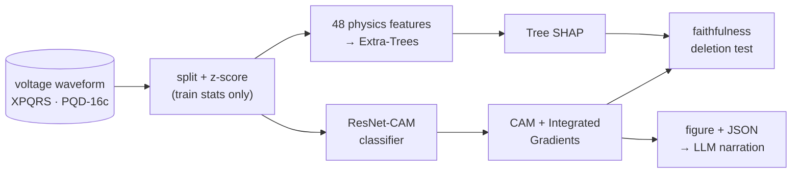
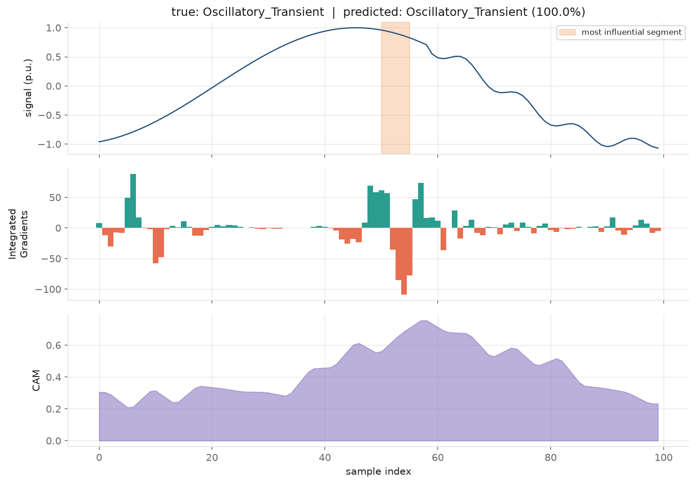

# Explainable Deep Learning for Power-Quality Disturbance Diagnosis

Classify power-quality disturbances (sag, swell, interruption, harmonics,
flicker, transients, notches and their combinations) from raw voltage
waveforms, **explain every prediction**, and **test whether those
explanations can be trusted**.

| | XPQRS (17 classes) | PQD-16c (16 classes) |
|---|---|---|
| **ResNet-CAM test accuracy** | **98.3 %** (macro-F1 0.983) | **88.8 %** (macro-F1 0.880) |
| Best baseline | 98.4 % · CNN-Complex, 3× the parameters | 87.8 % · CNN-Complex |
| Explanation | Class Activation Map + Integrated Gradients | same + Tree SHAP on physics features |

* **One small, explainable model wins.** A 455 k-parameter ResNet with a
  CAM head matches or beats both baselines (1.0 M and 1.4 M parameters).
* **Explanations are measured, not assumed.** A deletion test scores every
  explanation method; physics-feature SHAP is the most faithful, CAM the least.
* **Interactive Qt app.** Hold a button to inject a sag, swell, transient … into
  a live 50 Hz waveform and watch the model classify and explain every cycle.
  See [docs/GUI.md](docs/GUI.md).
* **XAI caught a dataset bug.** In PQD-16c every *Interruption* signal has sag
  depth (never below 0.1 p.u.), which caps any model at ≈ 87.5 %. Details in
  [docs/XAI.md](docs/XAI.md#what-xai-revealed-about-pqd-16c).


## Pipeline



Architecture diagrams, training protocol and the faithfulness procedure are in
[docs/ARCHITECTURE.md](docs/ARCHITECTURE.md).

## Quick start

Requires **Python 3.10+** and about 2 GB of free RAM. No GPU needed.

### 1. Clone

```bash
git clone https://github.com/Chethan616/xai.git
cd xai
```

### 2. Create an environment and install

```bash
python -m venv .venv
source .venv/bin/activate          # Windows: .venv\Scripts\activate

pip install torch --index-url https://download.pytorch.org/whl/cpu   # CPU-only PyTorch (~200 MB)
pip install -r requirements.txt
```

Both datasets and the trained checkpoints are part of the repository — there is
nothing else to download.

### 3. Classify and explain a signal

```bash
python src/explain.py --dataset xpqrs --sample 4
```

```text
{
 "true_class": "Oscillatory_Transient",
 "predicted_class": "Oscillatory_Transient",
 "confidence": 0.9998,
 "top3": [["Oscillatory_Transient", 0.9998], ...],
 "most_influential_segment_samples": [50, 55],
 ...
}
figure: outputs/explanations/xpqrs_test0004.png
```

`--sample` is any index into the test split (0–3399 for XPQRS, 0–319 for
PQD-16c). Use `--dataset pqd16` for the 10-cycle dataset.



### 4. Launch the live GUI

```bash
python src/gui.py
```

Hold any disturbance button to inject it into the waveform; release to return
to a clean sine. Every cycle is a real XPQRS test window, classified live, with
the model's evidence shaded in orange. Full guide: [docs/GUI.md](docs/GUI.md).


### 5. Run the self-checks

```bash
python tests/test_faithfulness.py      # prints "ok"
python tests/test_stream.py            # prints "ok"
```

## Reproduce the results

Every command appends to `outputs/benchmark/results.jsonl` and saves its
checkpoint in `outputs/benchmark/ckpt/`. Times are for a 4-core laptop CPU.

```bash
# headline: ResNet-CAM + baseline on XPQRS (~30 + 45 min)
python src/train.py --dataset xpqrs --models resnet_cam cnn_complex --seeds 0 --epochs 40 --patience 15 --threads 4

# PQD-16c neural screen (~20–80 min per model)
python src/train.py --models resnet_cam cnn_complex cnn_res_bilstm resnet_cam_mv inception_cam_mv cycle_transformer \
                    --seeds 0 --epochs 70 --patience 25 --threads 4

# PQD-16c physics-feature models (~1 min)
python src/train_features.py

# explanation faithfulness
python src/faithfulness.py feat_extra_trees resnet_cam:outputs/benchmark/ckpt/resnet_cam_s0.pth
python src/faithfulness.py --dataset xpqrs resnet_cam:outputs/benchmark/ckpt/xpqrs_resnet_cam_s0.pth

# all figures in docs/figures
python src/make_figures.py
```

Available models: `resnet_cam`, `resnet_cam_mv`, `inception_cam`,
`inception_cam_mv`, `cycle_transformer`, `cnn_complex`, `cnn_res_bilstm`.
To use a newly trained model with `explain.py`, pass `--ckpt <path>`.

## Repository structure

```
├── src/
│   ├── data.py               dataset loaders and splits
│   ├── models.py             model zoo (MODELS registry)
│   ├── features.py           48 IEEE-1159-style physics features
│   ├── train.py              train / evaluate signal models
│   ├── train_features.py     train / evaluate feature models
│   ├── explain.py            classify + explain one signal
│   ├── stream.py             GUI signal source + live classifier (no Qt)
│   ├── gui.py                Qt live disturbance explainer
│   ├── faithfulness.py       deletion test for explanations
│   ├── make_figures.py       regenerate docs/figures
│   └── legacy/               first-iteration SHAP and attention scripts
├── tests/                    self-checks (faithfulness test, GUI stream)
├── notebooks/                exploration notebooks 01–05 (+ archive/)
├── dataset/                  XPQRS and PQD-16c CSVs — see dataset/README.md
├── models/                   resnet_cam_xpqrs.pth, resnet_cam_pqd16.pth,
│                             resnet_cam_xpqrs_sync.pth (GUI), legacy/
├── outputs/benchmark/        results.jsonl, faithfulness.json
└── docs/                     ARCHITECTURE · RESULTS · XAI · GUI, figures/, diagrams/, papers/
```

## Documentation

| Document | Contents |
|---|---|
| [docs/ARCHITECTURE.md](docs/ARCHITECTURE.md) | pipeline, ResNet-CAM architecture, models compared, training protocol, faithfulness procedure |
| [docs/RESULTS.md](docs/RESULTS.md) | full benchmark tables, per-class F1, confusion matrices, sanity checks, limitations |
| [docs/XAI.md](docs/XAI.md) | explanation methods, example explanations, faithfulness results, the PQD-16c label finding, LLM hand-off |
| [docs/GUI.md](docs/GUI.md) | using the Qt app, where its waveforms come from, the GUI model, how it works |
| [dataset/README.md](dataset/README.md) | dataset sources, formats, splits, known issues, citation |
| [src/legacy/README.md](src/legacy/README.md) | first-iteration SHAP pipeline |

## Limitations

* Neural results are from a single seed.
* XPQRS is synthetic and noise-free; robustness at 20–40 dB SNR is untested.
* PQD-16c accuracy is bounded by its Sag/Interruption labelling (≈ 87.5 %).

## Acknowledgements

* XPQRS dataset — M. U. Khan, S. Aziz, A. Usman, *Measurement* 216 (2023)
  112889, [doi:10.1016/j.measurement.2023.112889](https://doi.org/10.1016/j.measurement.2023.112889), CC BY 4.0.
* PQD-16c dataset — [Kaggle](https://www.kaggle.com/datasets/jkexin/pqd-16c-data).
* ResNet / FCN for time series — Wang, Yan, Oates (2017); CAM — Zhou et al. (2016);
  InceptionTime — Fawaz et al. (2020); Integrated Gradients — Sundararajan et al. (2017);
  SHAP — Lundberg & Lee (2017).
* Reference papers that shaped this project are in [docs/papers/](docs/papers/).
