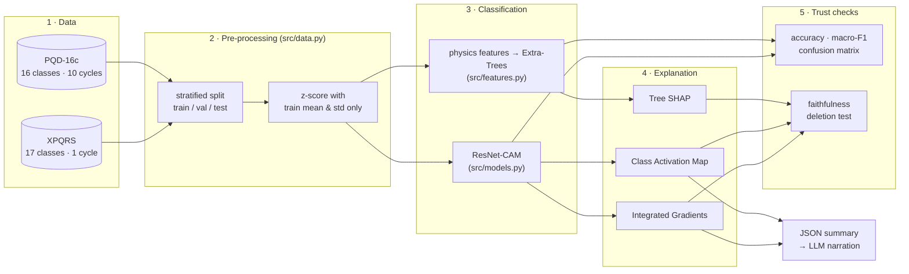
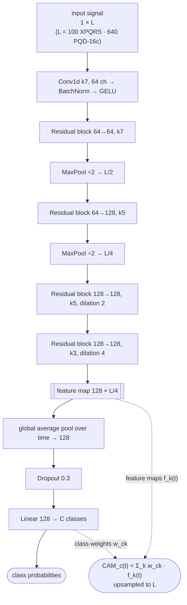
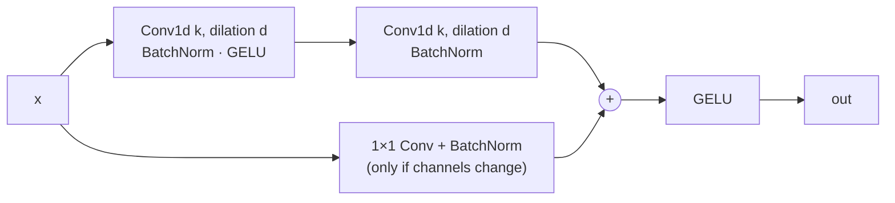
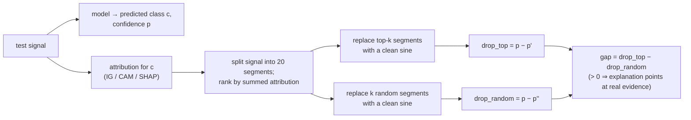

# Architecture

The diagrams below are Mermaid (rendered by GitHub). Standalone copies for
slides and reports — SVG and 3× PNG — are in [`diagrams/`](diagrams/), with
their `.mmd` sources.

## 1. End-to-end pipeline



| Stage | Code | Output |
|---|---|---|
| Load + split + normalise | `src/data.py` | `X, y, raw, class_names, mean, std` |
| Train signal models | `src/train.py` | `outputs/benchmark/results.jsonl`, checkpoints |
| Train feature models | `src/train_features.py` | same results file |
| Explain one signal | `src/explain.py` | PNG + JSON in `outputs/explanations/` |
| Faithfulness test | `src/faithfulness.py` | `outputs/benchmark/faithfulness.json` |
| Figures for the docs | `src/make_figures.py` | `docs/figures/*.png` |
| Live GUI | `src/stream.py` + `src/gui.py` | interactive Qt window ([GUI.md](GUI.md)) |

## 2. Selected model — ResNet-CAM

A fully-convolutional 1-D ResNet followed by global average pooling (GAP) and a
single linear layer (Wang et al. 2017, *Time-series classification from
scratch*). Because the classifier is one linear layer on top of GAP, the class
score decomposes exactly over time, which gives a **Class Activation Map** for
free (Zhou et al. 2016). 455 k parameters.



**Residual block** (used four times):



Dilations 2 and 4 in the last two blocks widen the receptive field to cover a
full cycle without further down-sampling, so the CAM keeps a resolution of 4
input samples.

## 3. Models compared

| Model | Idea | Params | Built-in explanation |
|---|---|---|---|
| `cnn_res_bilstm` (baseline 1) | residual CNN → 2-layer BiLSTM → additive attention | 1.0 M | attention weights |
| `cnn_complex` (baseline 2) | multi-scale (k 3/5/7) stem → 4 residual blocks → MLP head | 1.42 M | — |
| **`resnet_cam`** | ResNet + GAP + linear (above) | **455 k** | **CAM** |
| `resnet_cam_mv` | ResNet-CAM with two extra input views computed inside the model: sliding 1-cycle RMS and a one-cycle-difference high-pass | 456 k | CAM |
| `inception_cam_mv` | InceptionTime (Fawaz et al. 2020), depth 6, GAP head, multiview | 474 k | CAM |
| `cycle_transformer` | half-cycle patches → 3-layer Transformer, CLS token | 236 k | attention per half-cycle |
| `feat_*` | 48 physics features (`src/features.py`) → logistic regression / random forest / extra-trees / gradient boosting | — | Tree SHAP |

The physics features follow IEEE 1159 vocabulary so every attribution reads
like an engineer's note: per-cycle RMS, minimum/maximum sliding RMS, time below
0.9 / 0.5 / 0.1 p.u. and above 1.1 p.u., crest factor, harmonic ratios
(2nd–11th) and THD, flicker side-band energy, residual-transient energy, etc.

## 4. Training protocol (identical for every signal model)

| Setting | Value |
|---|---|
| Optimiser | AdamW, lr 2e-3, weight decay 1e-4 |
| Schedule | One-cycle, 15 % warm-up, stepped per batch |
| Batch | 64, gradient-norm clip 1.0 |
| Loss | cross-entropy |
| Model selection | best validation accuracy (ties → lower validation loss) |
| Epochs / patience | PQD-16c 70 / 25 · XPQRS 40 / 15 |
| Threads | CPU only (4 threads) — no GPU needed |

The test split is touched exactly once, after selection.

## 5. Faithfulness test



Contiguous segments are deleted for **both** arms so that the random baseline
is not penalised by the many sharp edges that scattered single-sample edits
create. For feature models the "segment" is a single feature and the
replacement is the median value of the Normal class.
`tests/test_faithfulness.py` checks the procedure on a toy model with known
evidence.

## 6. Repository layout

```
├── README.md
├── requirements.txt          core dependencies (requirements-lock.txt = original frozen env)
├── src/
│   ├── data.py               dataset loaders + splits
│   ├── models.py             model zoo (MODELS registry)
│   ├── features.py           48 physics features
│   ├── train.py              train/evaluate signal models
│   ├── train_features.py     train/evaluate feature models
│   ├── explain.py            classify + explain one signal (PNG + JSON)
│   ├── faithfulness.py       deletion test for explanations
│   ├── make_figures.py       regenerate docs/figures
│   ├── stream.py             GUI signal source + live classifier (no Qt)
│   ├── gui.py                Qt live disturbance explainer
│   └── legacy/               first-iteration SHAP / attention scripts
├── tests/                    test_faithfulness.py, test_stream.py
├── notebooks/                01–05 original exploration notebooks, archive/
├── dataset/                  XPQRS + PQD-16c CSVs, README
├── models/                   final checkpoints (+ legacy/ first-iteration ones)
├── outputs/benchmark/        results.jsonl, faithfulness.json
└── docs/                     ARCHITECTURE · RESULTS · XAI · GUI, figures/, diagrams/, papers/
```
