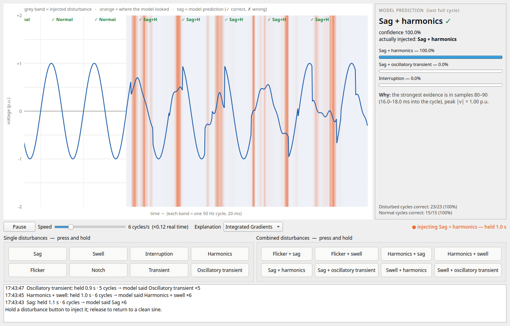
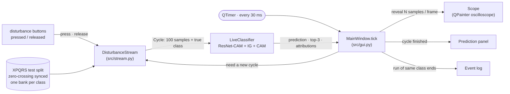

# Live disturbance explainer (GUI)

A desktop application, written with **Qt for Python (PySide6, widgets only)**,
that lets you *play* power-quality disturbances into a live waveform and watch
the model classify and explain every cycle as it arrives.



```bash
python src/gui.py                 # start the app
python src/gui.py --speed 3       # slower playback (cycles per second, 1-25)
```

## How to use it

1. **Normal operation.** The oscilloscope scrolls a clean 50 Hz sine. Every
   finished cycle gets a tag at the top — `✓ Normal` in green when the model
   agrees, a red `✗ <class>` when it does not.
2. **Inject a disturbance.** Press and **hold** any of the 16 buttons. From the
   next cycle on, the waveform becomes that disturbance and stays that way for
   as long as the button is held. The status text shows what is being injected
   and for how long. A quick click still injects exactly one cycle.
3. **Release** — the waveform returns to the clean sine on the next cycle.
4. **Read the explanation.**
   * grey band = cycles that were injected (ground truth);
   * orange shading = where the model found its evidence (Integrated
     Gradients by default; switch to the Class Activation Map or turn it off
     with the *Explanation* menu);
   * the right-hand panel shows the prediction for the last full cycle, its
     confidence, the top-3 classes, what was actually injected, and *why* —
     the 2 ms window with the strongest evidence and the cycle's peak voltage;
   * the log at the bottom summarises every hold: class, how long it was
     held, number of cycles, and what the model called each cycle.
5. **Speed / Pause.** Real time is 50 cycles per second — far too fast to
   read — so playback defaults to 6 cycles/s (×0.12). The slider goes from 1
   to 25 cycles/s.

| Control | Effect |
|---|---|
| Disturbance buttons (8 single + 8 combined) | hold to inject that class |
| Speed slider | playback speed, 1–25 cycles per second |
| Explanation menu | Integrated Gradients · Class Activation Map · none |
| Pause / Resume | freeze the scope to inspect a cycle |

## Where the waveforms come from

Nothing is synthesised. Every cycle shown — including the "normal" sine — is a
real window from the **XPQRS test split**, which the model never saw during
training. For each new cycle the app picks a random test window of the
currently selected class (`Pure_Sinusoidal` when no button is held).

XPQRS windows are one cycle long but most classes start at a random phase, so
gluing them end-to-end would create false steps at every joint (which look
exactly like transients). The app therefore uses **zero-crossing-synchronised**
windows: each window is circularly shifted so its fundamental starts at a
rising zero crossing (`data.sync_to_zero_crossing`). This is the same framing
a power-quality analyser uses (IEC 61000-4-30 synchronises its measurement
windows to the fundamental), and it makes consecutive cycles join smoothly.

## The model behind the GUI

Shifting the windows changes what the network sees: the benchmark model,
trained on the original phases, drops from 98.3 % to 81 % on synchronised
windows because it had learned the phase at which each class starts. The GUI
therefore uses its own checkpoint, **`models/resnet_cam_xpqrs_sync.pth`** — the
same ResNet-CAM architecture, trained with the same protocol on synchronised
windows:

| Checkpoint | Trained on | Test accuracy | Macro-F1 |
|---|---|---|---|
| `models/resnet_cam_xpqrs.pth` (benchmark) | original XPQRS windows | 98.3 % | 0.983 |
| `models/resnet_cam_xpqrs_sync.pth` (GUI) | zero-crossing-synchronised windows | 98.1 % | 0.981 |

Every class scores F1 ≥ 0.95 (weakest: *Oscillatory_Transient* 0.95, *Sag* 0.96).
The GUI classifies **exactly** the samples it draws, so what you see is what
the model gets; running the GUI's own inference path over all 3 400
synchronised test windows reproduces the 98.1 %.

Retrain it with:

```bash
python src/train.py --dataset xpqrs_sync --models resnet_cam --seeds 0 --epochs 40 --patience 15 --threads 4
cp outputs/benchmark/ckpt/xpqrs_sync_resnet_cam_s0.pth models/resnet_cam_xpqrs_sync.pth
```

### Known limitation: the synchronisation seam

A circular shift joins the window's original last sample to its original first
sample. For disturbances that start or stop *inside* the 20 ms window (e.g.
the sag onset in *Sag + harmonics*), that joint shows up as a small step in
every cycle — visible in the screenshot above — and the Integrated-Gradients
strip often lights up on it, i.e. the GUI model partly uses the seam as
evidence. The benchmark model (`resnet_cam_xpqrs.pth`, unshifted windows) has
no seam. Removing it properly needs multi-cycle recordings, so the stream
could be cut at true zero crossings instead of rotated; XPQRS only provides
single cycles.

## How it works



* **`stream.DisturbanceStream`** (no Qt) holds one bank of test windows per
  class. `press(name)` / `release(name)` set the active class;
  `next_cycle()` returns a window of the active class, or `Pure_Sinusoidal`.
  A press-and-release that happens between two cycles is remembered as a
  *tap*, so even the shortest click yields one disturbed cycle.
* **`stream.LiveClassifier`** (no Qt) normalises the cycle with the training
  statistics, runs ResNet-CAM once for the probabilities and the CAM, and runs
  Integrated Gradients (16 steps, batched in one forward/backward pass, against
  a clean-sine baseline). IG is skipped for clean cycles that the model also
  calls clean (nothing to explain). Measured on a 4-core laptop CPU: ~6 ms per
  clean cycle, ~31 ms per disturbed cycle — fast enough for the 25 cycles/s
  maximum speed.
* **`gui.MainWindow.tick`** runs every 30 ms. It converts elapsed time ×
  speed into a number of samples to reveal; whenever the newest cycle is
  complete it fetches and classifies the next one. A button pressed mid-cycle
  therefore takes effect at the next cycle boundary — the same latency a real
  cycle-based monitor has.
* **`gui.Scope`** is a custom `QWidget` painted with `QPainter`: grid and
  p.u. axis, grey bands for injected cycles, the attribution as a smoothed
  orange heat strip, the waveform as one antialiased path, and a ✓/✗ tag per
  cycle. No plotting library is involved.

## Command-line options

| Option | Default | Meaning |
|---|---|---|
| `--speed N` | 6 | playback speed in cycles per second (1–25) |
| `--ckpt PATH` | `models/resnet_cam_xpqrs_sync.pth` | checkpoint to load (relative to the repo root) |
| `--demo PNG` | — | run a scripted sequence of presses, save a screenshot to `PNG`, exit (used for `docs/figures/gui.png`; works headless with `QT_QPA_PLATFORM=offscreen`) |

## Tests

```bash
python tests/test_stream.py     # hold / tap / release semantics, phase sync, smooth joins
```

## Troubleshooting

| Symptom | Fix |
|---|---|
| `ModuleNotFoundError: PySide6` | `pip install -r requirements.txt` |
| "Checkpoint missing" dialog | train the GUI model (command above) or pass `--ckpt` |
| `qt.qpa.plugin: Could not load the Qt platform plugin "xcb"` (Linux) | `sudo apt install libxcb-cursor0` |
| Running over SSH / without a display | `QT_QPA_PLATFORM=offscreen python src/gui.py --demo out.png` |
