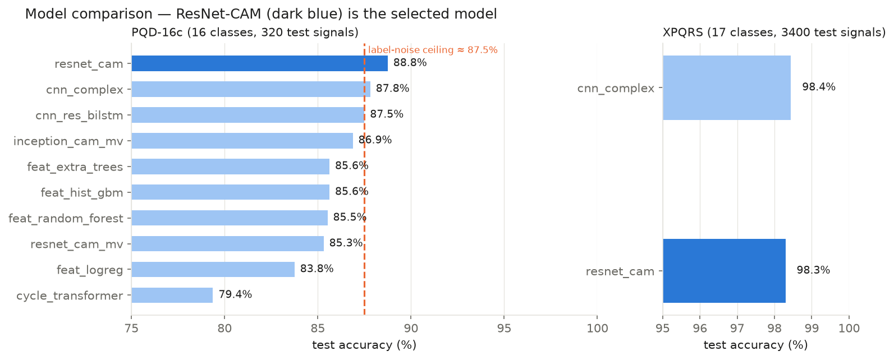
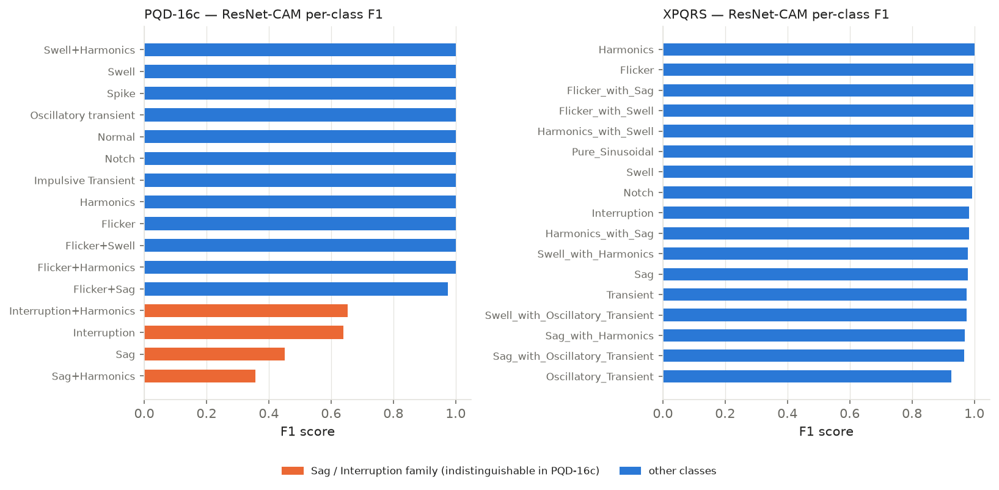
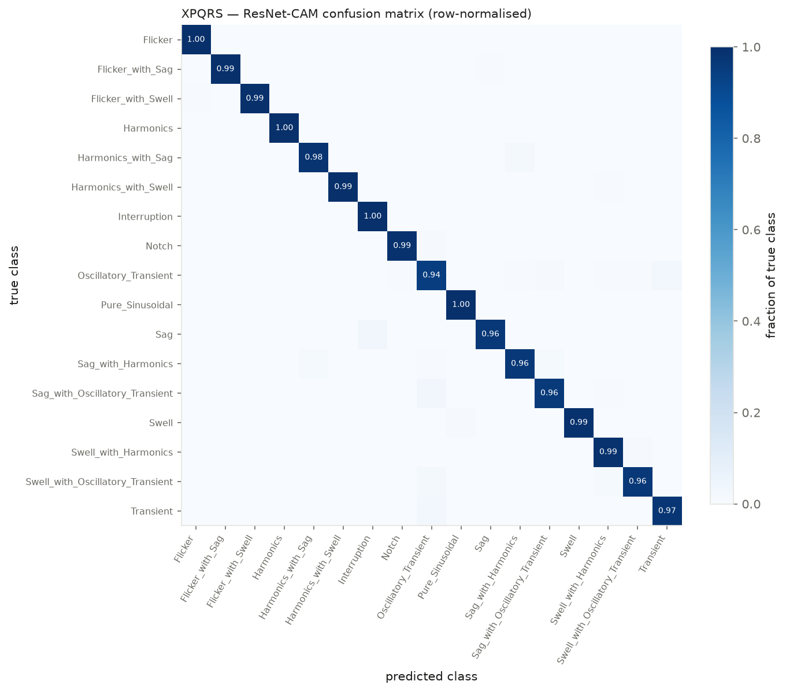
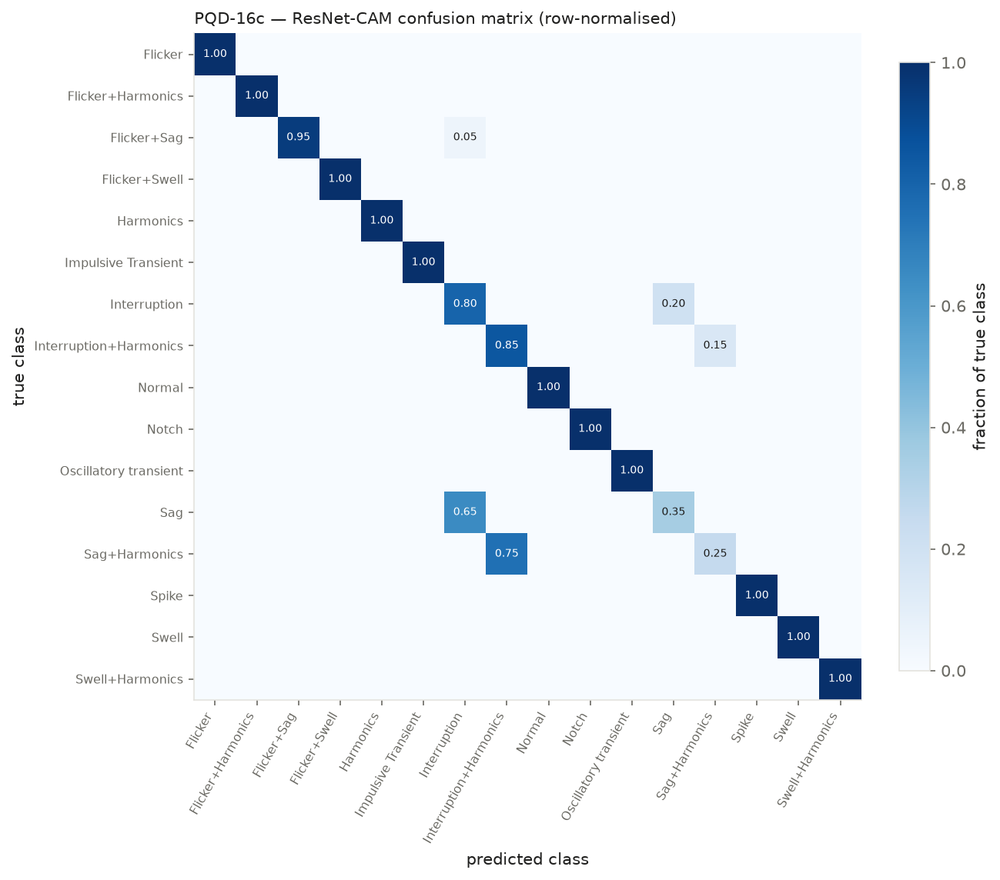

# Results

All numbers come from `outputs/benchmark/results.jsonl` and are reproduced by
the commands in the [README](../README.md#reproduce-the-results). Test sets were
used once, after model selection on the validation split. Figures are
regenerated with `python src/make_figures.py`.

## Headline

| Dataset | Model | Test accuracy | Macro-F1 | Params |
|---|---|---|---|---|
| **XPQRS** (17 classes, 3 400 test signals) | **ResNet-CAM** | **98.3 %** | **0.983** | 455 k |
| XPQRS | CNN-Complex (baseline) | 98.4 % | 0.984 | 1.42 M |
| PQD-16c (16 classes, 320 test signals) | **ResNet-CAM** | **88.8 %** | **0.880** | 455 k |
| PQD-16c | CNN-Complex (baseline) | 87.8 % | 0.876 | 1.42 M |
| PQD-16c | CNN-Res-BiLSTM (baseline) | 87.5 % | 0.875 | 1.0 M |
| XPQRS, zero-crossing-synchronised (GUI model) | ResNet-CAM | 98.1 % | 0.981 | 455 k |

ResNet-CAM is the selected model: it matches the strongest baseline on XPQRS
(the 0.15-point gap is 5 of 3 400 test signals) and beats both baselines on
PQD-16c, with a third of the parameters and an exact built-in explanation.
The synchronised variant powers the live GUI — see [GUI.md](GUI.md#the-model-behind-the-gui)
for why it exists.

## Full PQD-16c screen

Seed 0 for neural models; feature models are the mean over seeds 0–2 (logistic regression: seed 0 only).

| Model | Test acc | Macro-F1 | Params | Train time (CPU) |
|---|---|---|---|---|
| resnet_cam | 88.8 % | 0.880 | 455 k | 21 min |
| cnn_complex | 87.8 % | 0.876 | 1.42 M | 39 min |
| cnn_res_bilstm | 87.5 % | 0.875 | 1.0 M | 24 min |
| inception_cam_mv | 86.9 % | 0.869 | 474 k | 80 min |
| feat_extra_trees | 85.6 % | 0.855 | 48 features | < 1 min |
| feat_hist_gbm | 85.6 % | 0.856 | 48 features | 1 min |
| feat_random_forest | 85.5 % | 0.852 | 48 features | < 1 min |
| resnet_cam_mv | 85.3 % | 0.837 | 456 k | 21 min |
| feat_logreg | 83.8 % | 0.836 | 48 features | < 1 min |
| cycle_transformer | 79.4 % | 0.786 | 236 k | 6 min |

## Per-class behaviour

* **PQD-16c:** 12 of 16 classes score F1 ≥ 0.97. The four orange classes are
  the Sag / Interruption family, which the dataset labels inconsistently (see
  [XAI.md](XAI.md#what-xai-revealed-about-pqd-16c)); every model, whatever its
  architecture, sits at chance level within each pair. The resulting ceiling is
  ≈ 12/16 × 100 % + 4/16 × 50 % = 87.5 %.
* **XPQRS:** every class scores F1 ≥ 0.92. The weakest is
  *Oscillatory_Transient* (0.93), occasionally confused with *Transient* and
  the compound oscillatory classes — inside a single 20 ms cycle a short
  oscillation and an impulse look similar.

| XPQRS confusion | PQD-16c confusion |
|---|---|
|  |  |

## Checks on the headline number

| Check | Result |
|---|---|
| Exact train/test duplicates (XPQRS) | 201 / 3 400 — all *Pure_Sinusoidal* (one signal repeated) plus 1 *Swell* |
| Accuracy without those duplicates | 98.2 % (n = 3 199) |
| Test-set size | 200 signals / class, so ±0.5 % is roughly one standard error |

## Limitations

* Single training seed for the neural models; seeds 1–2 would give a spread.
* XPQRS is noise-free and synthetic. Published work also reports accuracy at
  20–40 dB SNR; that robustness test has not been run here.
* PQD-16c results are bounded by its label noise, not by the models.
