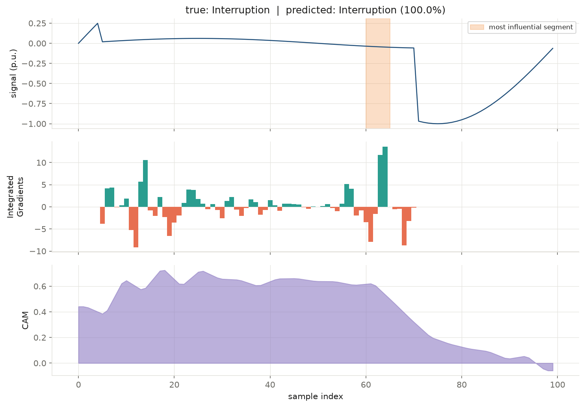
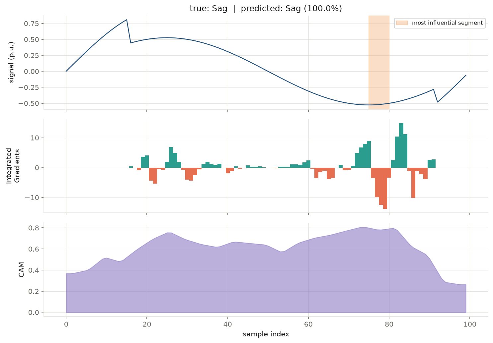
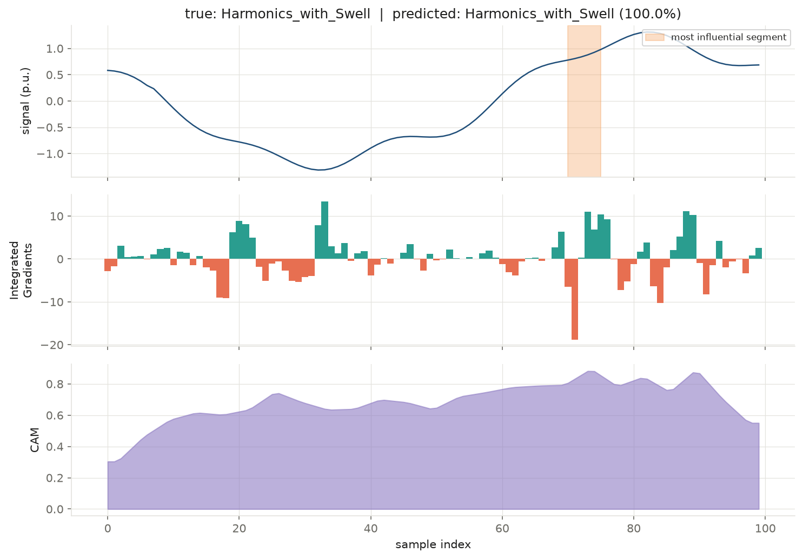
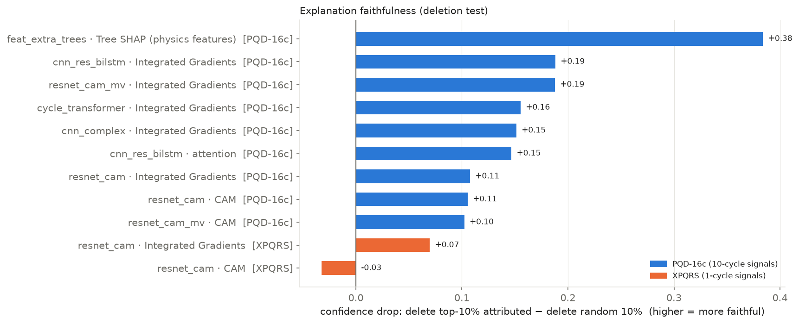
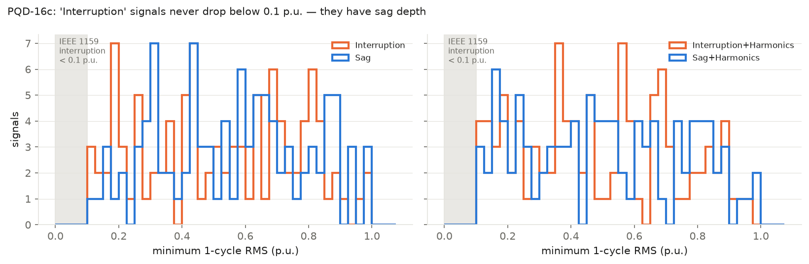

# Explainability (XAI)

Three explanation methods are used, each matched to a model family, and every
one of them is **tested** rather than trusted: a deletion test measures whether
an explanation points at evidence the model actually relies on.

## Methods

| Method | Applies to | What it returns | Cost |
|---|---|---|---|
| **Class Activation Map (CAM)** | ResNet-CAM, InceptionTime-CAM | per-time-step evidence for each class: `CAM_c(t) = Σ_k w_ck f_k(t)` | free (one forward pass) |
| **Integrated Gradients (IG)** | any differentiable model | per-sample attribution, integrated along the path from a clean 1 p.u. sine to the signal (32 steps) | 32 forward/backward passes |
| **Tree SHAP** | physics-feature tree models | per-feature Shapley value, e.g. "THD = 0.19 pushes towards *Harmonics*" | exact for trees |
| Attention weights | CNN-Res-BiLSTM baseline | weight per pooled time step | free |

The IG baseline is a **clean sine at nominal amplitude**, not zeros: the
question being answered is "what in this signal differs from a healthy supply
and drives the decision?", which is exactly the question a power engineer asks.

## Example explanations (XPQRS, ResNet-CAM)

`python src/explain.py --dataset xpqrs --sample <i>` produces these. Top panel:
waveform with the most influential 5-sample segment shaded; middle: IG (green
supports the predicted class, red opposes it); bottom: CAM.

| Interruption (99.99 %) | Oscillatory transient (99.98 %) |
|---|---|
|  |  |
| **Sag (100 %)** | **Harmonics with swell (100 %)** |
|  |  |

For the oscillatory transient, both IG and CAM concentrate on the onset of the
ringing (samples ≈ 50–60) and ignore the clean first half of the cycle — the
model looks where an engineer would look.

## Are the explanations faithful?

**Deletion test** (`src/faithfulness.py`, diagram in
[ARCHITECTURE.md](ARCHITECTURE.md#5-faithfulness-test)): replace the top-k %
most-attributed segments with a clean sine and measure the confidence drop;
do the same for k % random segments; report the **gap**. A gap > 0 means the
explanation identified evidence the model really uses. 160 test signals
(PQD-16c) / 340 (XPQRS).



| Model · method | gap @5 % | gap @10 % | gap @20 % |
|---|---|---|---|
| feat_extra_trees · Tree SHAP (PQD-16c) | **0.27** | **0.38** | **0.37** |
| cnn_res_bilstm · IG (PQD-16c) | 0.13 | 0.19 | 0.32 |
| cnn_complex · IG (PQD-16c) | 0.10 | 0.15 | 0.28 |
| resnet_cam · IG (PQD-16c) | 0.10 | 0.11 | 0.20 |
| resnet_cam · CAM (PQD-16c) | 0.07 | 0.11 | 0.16 |
| resnet_cam · IG (XPQRS) | 0.06 | 0.07 | 0.10 |
| resnet_cam · CAM (XPQRS) | 0.03 | −0.03 | −0.17 |

Findings:

1. **Physics-feature SHAP is the most faithful explanation** — its gap is 2–4×
   that of any time-localised method. A statement like "minimum RMS = 0.05 p.u."
   captures a whole disturbance in one number, so deleting it removes the
   evidence completely.
2. **Time-localised maps work well on 10-cycle signals** (PQD-16c): a sag or a
   transient occupies a few cycles, so there is a region to point at. IG is the
   most dependable method across architectures.
3. **On 1-cycle signals (XPQRS) they barely beat random.** Harmonics, flicker
   and swell change *every* sample of a 20 ms window; there is no single region
   holding the evidence. CAM is only reliable for its single top segment. IG
   stays positive and is the recommended map for XPQRS.
4. Ratios (top-drop ÷ random-drop) are **not** reported at 5 % because the
   random drop is ≈ 0 there and the ratio explodes (e.g. 1 000×); the gap is the
   honest metric.

## What XAI revealed about PQD-16c

Every PQD-16c model — CNN, BiLSTM, Transformer, InceptionTime, tree ensembles —
failed on the same four classes: *Interruption*, *Sag*,
*Interruption+Harmonics*, *Sag+Harmonics* (F1 ≈ 0.35–0.65). Tree SHAP on
those four classes splits the attribution in two: harmonic and residual
features (`cycles_with_residual_blip`, `harmonic_5/7_ratio`, `THD`, …) carry
most of it and separate the plain classes from their *+Harmonics* variants,
while the magnitude/RMS features (`halfcycle_peak_min`, `rms_min`, …) carry
38 % and are the only ones that could separate a sag from an interruption.
Interruption and sag differ *only* in depth, so we inspected depth per class:



The *Interruption* signals never go below 0.1 p.u. — the IEEE 1159 definition
of an interruption — and their depth distribution is the same as *Sag*'s. The
dataset generator gave interruptions sag depth, so the labels cannot be
separated from the signal by any model. This is why the project reports
XPQRS as the headline dataset, and it is the clearest example in this work of
an explanation exposing a **data** problem rather than a model problem.

## Hand-off to an LLM

`src/explain.py` writes a compact JSON next to each figure, designed as the
input to a language model that narrates the decision for a non-expert:

```json
{
 "dataset": "xpqrs",
 "true_class": "Oscillatory_Transient",
 "predicted_class": "Oscillatory_Transient",
 "confidence": 0.9998,
 "top3": [["Oscillatory_Transient", 0.9998],
          ["Sag_with_Oscillatory_Transient", 0.0002],
          ["Swell_with_Oscillatory_Transient", 0.0]],
 "most_influential_segment_samples": [50, 55],
 "signal_peak_pu": 1.068
}
```

The legacy pipeline in `src/legacy/` contains the first-iteration SHAP
(GradientExplainer) and attention explainers for the original checkpoints in
`models/legacy/`.

## Next steps

* Physics-feature model for XPQRS (features adapted to one cycle) to get the
  more faithful Tree SHAP explanations on the headline dataset.
* Noise-robustness evaluation at 20–40 dB SNR.
* Extra seeds for the neural models.
